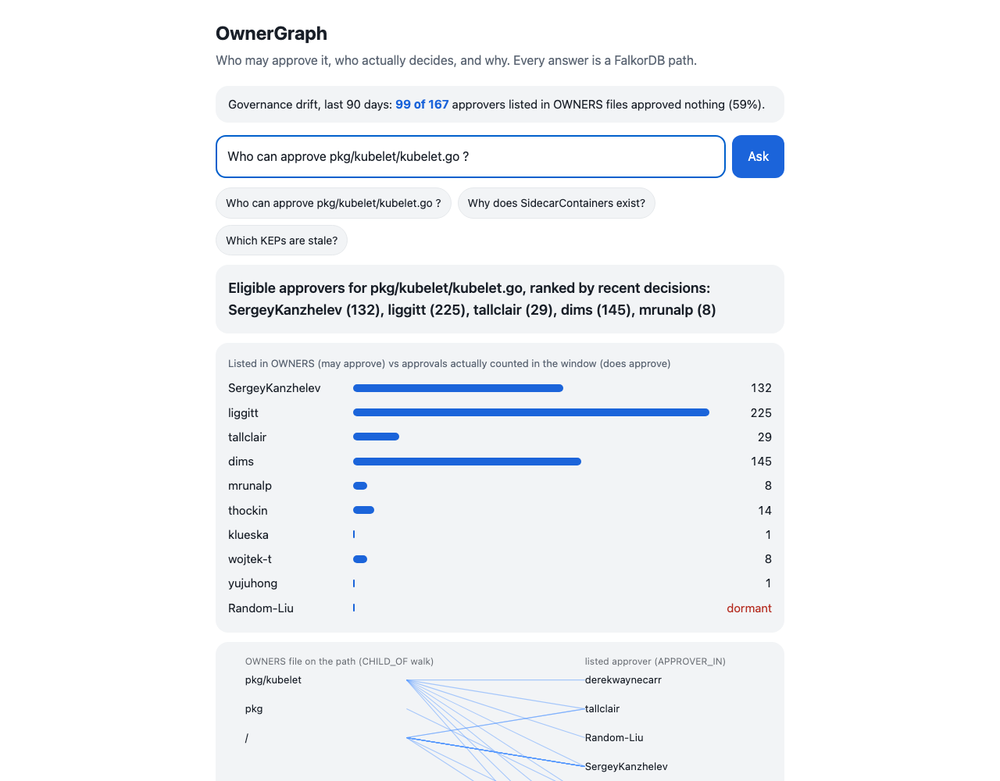
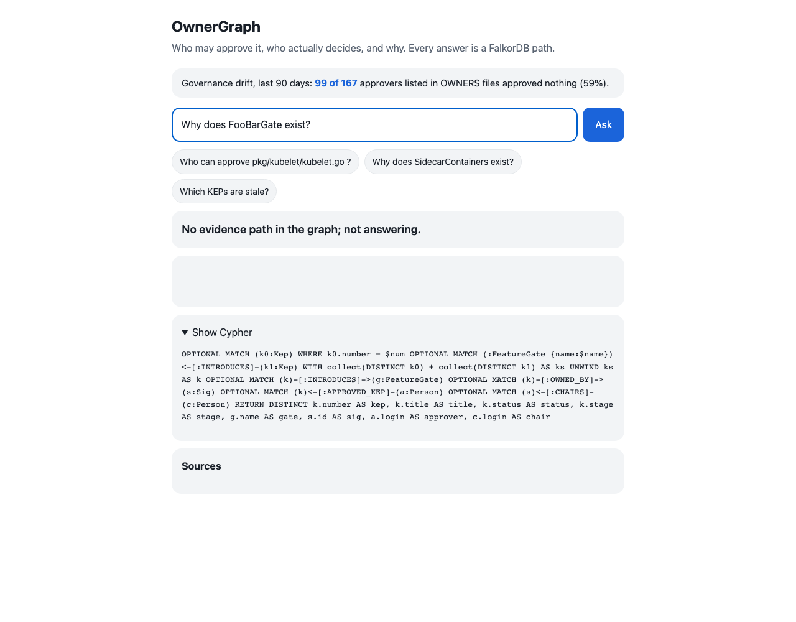

# OwnerGraph

**Who may approve it, who actually decides, and why - as a FalkorDB path an agent can show its work on.**

Kubernetes is a public organisation of 1000+ people that works like a company. OwnerGraph loads its teams (SIGs), approval
rights (OWNERS files), design decisions (KEPs) and the real approval history of merged PRs into **one FalkorDB graph**. An agent then
answers "who can approve this change, who has actually been approving this area, and why was it decided" with the Cypher it ran,
the graph path, and links to the source on GitHub - and says **"no evidence"** instead of guessing when there is no path.

Entered in **Track 03 - Company Brain** and **Track 01 - Agents That Act on Connected Data**.

- Try it (no account, no login): **live demo <https://wheel-angeles-beings-reception.trycloudflare.com>** (the docker image below, served from the author's laptop through a Cloudflare quick tunnel - it can be offline, the setup below always works) - or `make setup load demo` and open <http://127.0.0.1:8000>.
- Demo video (2:12, English narration with subtitles): <https://youtu.be/uq5-OIXHNbk> - blog post: [docs/blog.md](docs/blog.md)
- Built during Graph Hacks (Oct 15-18, 2026). Before the window only design notes and a graph sketch existed; the first commit of this repository is the failing test suite (`git log --reverse`).

## At a glance

| Same LLM, 60 frozen questions (E2) | FalkorDB graph agent | Vector RAG (same LLM) | LLM alone |
|---|---|---|---|
| Multi-hop, n=40 | **95.0%** | 22.5% | 0.0% |
| Single-hop, n=20 | 100.0% | 95.0% | 0.0% |


Eval as passes over total (same frozen set): graph agent **58/60** correct (single-hop 20/20, multi-hop 38/40); vector RAG 28/60 (19/20 and 9/40); LLM alone 0/60.

Take FalkorDB away and multi-hop accuracy falls by 72.5 points (single-hop lookups stay competitive for retrieval - we report that too).
Metric used throughout (README, video, blog): **hit@3 = the share of evaluated pull requests whose real approver is among the top three suggested approvers.**



*One answer (1280 px). Every row is a FalkorDB result; "dormant" marks a listed approver with no approval in the window; the executed Cypher and the GitHub sources are on the same screen. When no path exists the product says so instead of guessing:*



A 390 px capture is in `docs/img/answer-390.png`.

## Similar tools (and what only this has)

| Tool | What it does | Decisions + approval rights + real approval history in one graph? |
|---|---|---|
| FalkorDB/RepoGraph (sponsor, github.com/FalkorDB/RepoGraph) | git history graph: bus factor, who knows what, reviewer suggestion | partly - no design decisions, no OWNERS |
| FalkorDB code-graph / GraphRAG-SDK / FalkorDB-MCPServer (sponsor) | code graph demo, document -> cited answers, Cypher MCP | no - we *use* these building blocks |
| Prow blunderbuss/approvers (kubernetes-sigs/prow) | assigns reviewers/approvers from OWNERS rules | partly - rules only, no history; **our E1 baseline (a)** |
| Korca Triage Agent (Neo4j Aura hackathon, github.com/alterminder/korca-aura-agent) | routes tickets over a people/team/skill graph | partly - routing only, synthetic data |
| Cortex (github.com/aniruddhaadak80/cortex) and Axon (github.com/volfiros/axon-brain), this hackathon | company-brain agents: who worked on X; decision capture with citations | partly - synthetic data, no approval rights, no measured evaluation |
| Dosu, GitHub AI issue intake, Unblocked | issue labelling / triage / context engines | partly - no graph, no decision provenance |
| k8s-dev-mcp (glama.ai) | lists KEPs and SIGs over MCP | partly - lookup only |

**Only OwnerGraph**: a real 1000+ person organisation, with *decision source (KEP) + approval authority (OWNERS inheritance) + actual
approval history (PRs)* joined in one graph, and a published, pre-registered, time-split evaluation of "who really approves" against
the OWNERS rules - including where it does not win.

## Results (generated by `make eval`; a test fails if this block and `results/*.json` disagree)

<!-- numbers:start -->
- E1 evaluated PRs (merged after cutoff, with a non-author approver): 716
- E1 prow_owners_random [all] hit@3: 23.0% (hit@1 11.9%, n=716)
- E1 prow_owners_random [hard] hit@3: 25.0% (hit@1 14.5%, n=344)
- E1 prow_owners_random [no_nearby_history] hit@3: 27.3% (hit@1 12.1%, n=33)
- E1 prow_owners_random [eligible_all_inactive] hit@3: 28.6% (hit@1 14.3%, n=35)
- E1 tfidf_retrieval [all] hit@3: 73.2% (hit@1 54.2%, n=716)
- E1 tfidf_retrieval [hard] hit@3: 72.1% (hit@1 55.5%, n=344)
- E1 tfidf_retrieval [no_nearby_history] hit@3: 39.4% (hit@1 33.3%, n=33)
- E1 tfidf_retrieval [eligible_all_inactive] hit@3: 40.0% (hit@1 31.4%, n=35)
- E1 owners_history [all] hit@3: 76.4% (hit@1 51.0%, n=716)
- E1 owners_history [hard] hit@3: 75.6% (hit@1 47.7%, n=344)
- E1 owners_history [no_nearby_history] hit@3: 27.3% (hit@1 12.1%, n=33)
- E1 owners_history [eligible_all_inactive] hit@3: 28.6% (hit@1 14.3%, n=35)
- E1 graph_local_only [all] hit@3: 76.0% (hit@1 49.6%, n=716)
- E1 graph_local_only [hard] hit@3: 72.4% (hit@1 47.4%, n=344)
- E1 graph_local_only [no_nearby_history] hit@3: 0.0% (hit@1 0.0%, n=33)
- E1 graph_local_only [eligible_all_inactive] hit@3: 0.0% (hit@1 0.0%, n=35)
- E1 graph [all] hit@3: 80.3% (hit@1 53.5%, n=716)
- E1 graph [hard] hit@3: 80.8% (hit@1 55.2%, n=344)
- E1 graph [no_nearby_history] hit@3: 84.9% (hit@1 69.7%, n=33)
- E1 graph [eligible_all_inactive] hit@3: 85.7% (hit@1 71.4%, n=35)
- E1 graph minus owners_history [all] hit@3: +3.9 pp (95% CI +2.0 to +5.9, n=716)
- E1 graph minus owners_history [hard] hit@3: +5.2 pp (95% CI +1.7 to +8.7, n=344)
- E1 graph minus owners_history [no_nearby_history] hit@3: +57.6 pp (95% CI +39.4 to +75.8, n=33)
- E1 graph minus owners_history [eligible_all_inactive] hit@3: +57.1 pp (95% CI +37.1 to +74.3, n=35)
- E2 graph [single-hop, n=20] accuracy: 100.0%
- E2 graph [multi-hop, n=40] accuracy: 95.0%
- E2 rag [single-hop, n=20] accuracy: 95.0%
- E2 rag [multi-hop, n=40] accuracy: 22.5%
- E2 rag_k12 [single-hop, n=20] accuracy: 95.0%
- E2 rag_k12 [multi-hop, n=40] accuracy: 22.5%
- E2 llm_only [single-hop, n=20] accuracy: 0.0%
- E2 llm_only [multi-hop, n=40] accuracy: 0.0%
- E2 ablation (graph tools removed -> vector RAG), multi-hop drop: 72.5 pp
- Tests: 94/94 passing
- Problem size: OWNERS approver handles with zero approvals in the last 90 days (2026-07-19..2026-10-17): 99 of 167 (59.3%)
- Problem size: OWNERS files where at most a quarter of the listed approvers were active: 46
- Problem size: open KEPs whose recorded approvers hold no current approver or SIG-chair role: 45
<!-- numbers:end -->

How to read it, honestly:

- **E1 (time-split, 716 real merged PRs after 2026-08-01, answer = who actually approved).** The graph beats the strongest non-graph
  baseline (per-OWNERS-file approval counts with recency) overall by a small margin, and by a very large margin exactly where the
  baseline has nothing to look at (a directory with no recent approvals, or whose listed approvers all went quiet) because the graph
  can *back off* along `PARENT_OWNERS` and `LABELS` edges. On the pre-registered "hard segment" union the gain is **+5.2 points, below
  the +15 we pre-registered** - we publish it as a miss. The big gaps live in two small slices (33 and 35 PRs); treat them as a
  mechanism demonstration, not as a headline accuracy.
- **E2 (60 frozen questions, answer keys computed from the raw YAML by `scripts/make_e2_questions.py`).** Same LLM in all three
  systems; only the source of facts differs. Graph agent = LLM picks a tool, FalkorDB answers, the LLM only phrases the rows.
  Vector-RAG stand-in = tf-idf cosine over the same raw YAML chunks (not a neural embedder). On single-hop lookups a vector
  retriever is competitive - the table above shows the exact numbers, whatever they are.
- **hit@1 is a tie, not a win**: tf-idf retrieval 54.2% vs graph 53.5% on all 716 PRs, so the gain is in the top three, and mostly on slices where the baseline has nothing to look at.
- **E2 RAG baseline was fixed once, openly**: a 4-question smoke run showed the tf-idf retriever could not find "KEP-4656" or paths (tokenisation of ids and punctuation), which would have been an unfair strawman. We fixed the retriever (chunk-id index, punctuation split) before the frozen run and report it with k=6 and k=12 chunks. A first full run with a wrong Gemini model name scored 0% for every system; we added an abort guard (more than 25% errors stops the run) and re-ran from scratch.
- Weights of the graph back-off cascade were chosen on a **July validation split** (`results/val_tuning.json`), never on the August
  test set.

## Why the graph is not decoration (task rule 3)

Every answer is produced by a FalkorDB query; the LLM only chooses a tool and words the result. Remove FalkorDB and:
`eligible_approvers` (variable-length walk up `CHILD_OF` with `no_parent_owners` boundaries and alias expansion through `MEMBER_OF*0..3`),
`deciders` (five evidence tiers: same directory, same OWNERS scope, nearby, ancestor OWNERS, SIG-wide, plus earlier PRs of the same KEP)
and the decision trail (`FeatureGate <- Kep -> Sig <- Person`) have nothing to run on. The ablation in the E2 table (graph tools removed ->
vector RAG) shows the drop on multi-hop questions. The agent path is read-only: Cypher templates, a keyword guard
(`ownergraph/adapters/readonly_guard.py`) and `GRAPH.RO_QUERY` - "the model got to suggest and a read-only query got to decide".

## Quick start

```bash
# FalkorDB (one line):
docker run -d -p 6379:6379 falkordb/falkordb:latest

make setup           # python 3.12 venv (uv) with the dependencies
make load            # builds the demo graph from data/snapshot (~20 s, 8,000 nodes / 29,853 edges)
make demo            # UI + API on http://127.0.0.1:8000
make test            # the test suite
make eval            # tests + E1 + E2 + regenerates the numbers block above
```

No docker? The default is an embedded FalkorDB (falkordblite, no daemon): unset `FALKORDB_HOST` and everything above works as is.
With docker only: `docker build -t ownergraph . && docker run -p 8000:8000 -e FALKORDB_HOST=host.docker.internal ownergraph`
(a `docker-compose.yml` is included but was not run in our environment). `GEMINI_API_KEY` is optional: without it every answer is still the deterministic graph path; with it the
agent phrases the rows and plans free-form questions.

MCP server (seven tools, stdio): `python -m ownergraph mcp` - `find_entity`, `approvers_for_path`, `deciders_for_path`,
`explain_feature_gate`, `route_issue`, `stale_decisions`, `reviewer_centrality` (FalkorDB PageRank).

## Track 03 key focus -> where it is in the product

| Key focus (hackathon page) | Feature | Code / query | Demo video |
|---|---|---|---|
| Knowledge from docs, tickets, and chats in one graph | OWNERS files, KEP documents, SIG leadership and merged PRs in one graph (chats are out of scope: no login-gated data, rule 6) | `infrastructure/loader.py`, graph model below | 0:14 |
| Who owns what, and who knows what | `approvers_for_path`: OWNERS inheritance + aliases (who *may*) ranked by recent approvals (who *does*) | `Q_ELIGIBLE`, `Q_SELF/Q_SCOPE/...` in `adapters/falkordb_repository.py` | 0:17 |
| Tracing decisions back to their source | `explain_feature_gate`: gate -> KEP -> owning SIG -> approvers -> chairs, with the kep.yaml link | `Q_TRAIL` | 0:44 |
| Keeping knowledge current as things change | `SyncService` (incremental upsert since the last snapshot; changed KEP statuses reported - unit-tested, the GitHub poller that feeds it is the first item under What's next) and `stale_decisions` (orphaned decisions) | `application/sync.py`, `Q_STALE` | 0:57 |
| Answers with clear sources | every response carries the executed Cypher, the rows and GitHub URLs; no path -> "no evidence" | `application/ask.py`, UI "Show Cypher" | 0:35 and 1:12 |

## Graph data model

```
(Person)-[:APPROVER_IN]->(OwnersFile)-[:GOVERNS]->(Directory)-[:CHILD_OF]->(Directory)
(Person)-[:MEMBER_OF]->(Alias)-[:APPROVER_IN]->(OwnersFile)     (OwnersFile)-[:LABELS]->(Sig)
(Directory)-[:UNDER]->(OwnersFile)   (OwnersFile)-[:PARENT_OWNERS]->(OwnersFile)    (derived ownership shortcuts)
(Person)-[:CHAIRS|LEADS]->(Sig)
(Kep)-[:OWNED_BY|PARTICIPATES]->(Sig)   (Person)-[:AUTHORED_KEP|APPROVED_KEP]->(Kep)   (Kep)-[:INTRODUCES]->(FeatureGate)
(PR)-[:TOUCHES]->(Directory)   (Person)-[:AUTHORED_PR]->(PR)   (Person)-[:APPROVED_PR {at}]->(PR)   (PR)-[:IMPLEMENTS]->(Kep)
```

People are GitHub handles only. `sigs.yaml` name/company/email fields are dropped before loading (`domain/pii.py`, tested).

## The Cypher the product depends on

All templates live in `ownergraph/adapters/falkordb_repository.py` (and are shown verbatim in the UI "Show Cypher" panel):

- `Q_ELIGIBLE` - variable-length walk `(d)-[:CHILD_OF*0..30]->(a)` that stops at `no_parent_owners`, then `(Person)-[:MEMBER_OF*0..3]->(g)-[:APPROVER_IN]->(OwnersFile)`.
- `Q_SELF`, `Q_SCOPE`, `Q_NEARBY`, `Q_ANCESTOR` (`PARENT_OWNERS*1..2`), `Q_SIG`, `Q_KEP_PRS` - the evidence tiers of "who actually decides".
- `Q_TRAIL` - decision trail; `Q_STALE` - orphaned decisions; `Q_ROUTE` - issue -> SIG -> approvers -> open KEPs; `Q_FIND`.
- FalkorDB features used: variable-length paths and path predicates (`any(... nodes(p)[0..length(p)] ...)`), `GRAPH.RO_QUERY`
  read-only connections, multiple graphs in one server (`org:kubernetes`, `e1:kubernetes@2026-08-01`, `val`), the MCP protocol on top of the same repository,
  `UNWIND` batch loading, an embedded engine (falkordblite) and the docker image.

## Data sources (all public; nothing private, nothing login-gated)

| Data | Source | How | Licence / terms |
|---|---|---|---|
| OWNERS, OWNERS_ALIASES (snapshot at 2026-07-31 and at 2026-10-17) | github.com/kubernetes/kubernetes | raw.githubusercontent.com | Apache-2.0 |
| SIG leadership | github.com/kubernetes/community `sigs.yaml` | raw | Apache-2.0 (handles only) |
| KEPs (`kep.yaml`, 685) | github.com/kubernetes/enhancements | raw | Apache-2.0 |
| Merged PRs 2026-05-01..10-17 (1,940): title, body text, changed paths, approvers from the Prow `APPROVALNOTIFIER` comment | GitHub GraphQL API on kubernetes/kubernetes | `scripts/fetch_data.py` (personal token, ~150 points) | public repository data; comments are not redistributed - only the extracted approver handles |

`data/snapshot/` holds the compact, gzipped result (about 1 MB) so that `make load` and `make eval` work offline.

## AI usage (hackathon rules 11 and 13)

- Built with AI coding assistants (Claude Code with Claude models) working inside a spec-and-tests-first workflow: `SPEC.md` -> failing tests -> implementation.
- Runtime LLM: Google Gemini (`gemini-3.1-flash-lite`) is used only to pick a tool, phrase rows, and extract components from an issue text. It never produces a fact that is not in the returned graph rows.
- Human verification: every number in this README is generated from `results/*.json` and checked by a test; the E2 answer keys come from the raw YAML by a separate script and the question file was frozen in git before the agents ran; the author reviews the architecture, the evaluation design and the explanations before submission.

## What's next

| Milestone | Date | Target |
|---|---|---|
| Incremental sync from GitHub (webhook-free poller) | Nov 2026 | changed KEP statuses surface within 1 hour |
| Second organisation loaded with one command | Nov 2026 | any public org with OWNERS files, < 5 minutes |
| Issue routing evaluation (E3) | Dec 2026 | sig-label accuracy on 300 historical issues |

## Claims checked against the FalkorDB docs

| Claim in this README | Source (docs.falkordb.com, read 2026-10-18) |
|---|---|
| Agent path uses `GRAPH.RO_QUERY` ("runs a read-only openCypher query ... returns an error if the query attempts any write") | commands/graph.ro_query |
| `CALL algo.pageRank(label, relationship-type) YIELD node, score` | algorithms/pagerank |
| Variable-length patterns such as `-[:PLAYED_WITH*1..3]->` | cypher/match |
| One FalkorDB instance can hold many isolated graphs (we use `org:kubernetes`, `e1:kubernetes@2026-08-01`, `val`) | hackathon page: "one instance can hold thousands of isolated graphs" |

## Limits (measured on the demo graph)

8,000 nodes and 29,853 edges; `make load` takes about 20 s; API graph query median 4.4 ms over 20 calls (measured 2026-10-17, docker FalkorDB, laptop); the full Kubernetes snapshot is 586 OWNERS files, 685 KEPs and 1,940 PRs. Loading another organisation needs its OWNERS files and PR approvals in the same JSON shapes (`scripts/fetch_data.py`); that second organisation is the second item under What's next, not something shipped today.

## About the builder

Solo entry by [Ryugi62](https://github.com/Ryugi62). Earlier agent projects with the same spec-first, tests-first habit: [proofcall](https://github.com/Ryugi62/proofcall) (voice agent with measured guardrails), [signalpost-agent](https://github.com/Ryugi62/signalpost-agent) (deterministic exact-ID agent), [trifecta-gate](https://github.com/Ryugi62/trifecta-gate) (provenance gate for agent tool calls), [scar-tissue](https://github.com/Ryugi62/scar-tissue) (guardrails learned from agent logs).

## Layout

`ownergraph/domain` (pure rules) <- `application` (use cases, ports) <- `adapters` (FalkorDB, GitHub, Gemini, MCP, HTTP) <-
`infrastructure` (CLI, composition). `SPEC.md` has the acceptance criteria; `tests/` mirrors them.
